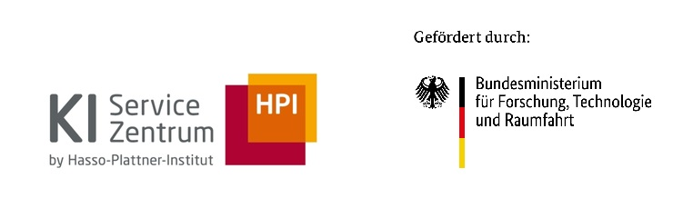
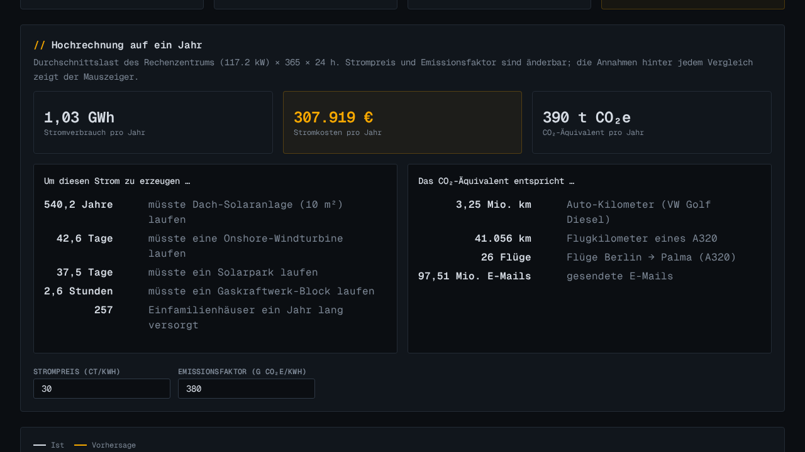
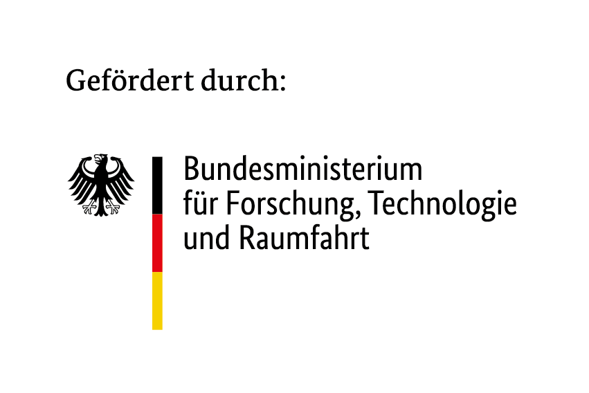

<div style="background-color: #ffffff; color: #000000; padding: 10px;">

<h1> datacenter-simulation — Stromrechner für KI-Rechenzentren
</div>

How much electricity does an AI datacenter draw in a year, what does it cost, and what is that in CO₂? This web tool estimates annual energy, electricity cost and CO₂ equivalent from a handful of specs (GPU type and count, workload, cooling) or from your own measurements, and translates the result into tangible comparisons. It also works backwards: give it an annual consumption and a GPU type, and it derives how many GPUs such a datacenter could have.



## Features

- **Datacenter from specs**: synthesizes an hourly load profile from GPU type and count, occupancy, chip load, MoE share, training/inference phase, PUE and climate; four named presets included.
- **Own measurements**: upload one or more CSVs; the tool joins them, picks the facility-wide meter as target and fits a forecast.
- **Annual projection**: energy per year, electricity cost (default 30 ct/kWh) and CO₂ equivalent (default 380 g/kWh), both editable.
- **Tangible comparisons**: rooftop PV, wind turbine, solar park and gas power plant runtime; single-family homes; car and A320 kilometres, Berlin → Palma flights, e-mails.
- **Inverse sizing**: annual consumption + GPU type → GPU count, transferable into the specs.
- **Explainable model**: linear regression on a time-separated hold-out with R², MAE, RMSE, standardized influence per feature, per-prediction breakdown and what-if sliders.
- **Raw data and correlations**: inspect every column as table or time series, and the full correlation matrix with partial correlation for a third variable.

## Setup and Installation

### Prerequisites

- Python 3.12 with [`uv`](https://docs.astral.sh/uv/)
- Node.js and npm

### Quick Start

1. Clone the repository:
   ```bash
   git clone https://github.com/aihpi/datacenter-simulation.git
   cd datacenter-simulation
   ```

2. Install dependencies:
   ```bash
   make setup
   ```

3. Start backend and frontend:
   ```bash
   make demo
   ```

4. Access the application:
   - Frontend: http://localhost:5173
   - Backend API: http://localhost:8000 (`/health`, `/predict`, `/synthesize`, `/raw`, `/correlations`)

`make help` lists the remaining targets (dataset generation, tests, smoke test, build).

## User Guide

### Using the Tool
1. **Vorhersage**: choose a data source — seed dataset, your own CSV(s), or *Aus Specs generieren*. The annual projection, cost, CO₂ and comparisons update immediately.
2. Adjust electricity price and emission factor under the projection; hover a comparison to see its assumption.
3. **Inverse Auslegung**: enter annual consumption (MWh), GPU type and PUE to get a GPU count; *In Specs übernehmen* feeds it back into the generator.
4. **Rohdaten** and **Zusammenhänge** show the data the model sees and how the columns relate.

### Recommendations
For a quick sanity check against a real cluster, generate from specs with the cluster's GPU count and compare the annual energy with the metered value. Example CSVs live in `data/synthetisch/` and `data/examples/`.

## Limitations

- **Model**: a linear regression; it captures the dominant drivers (GPU and CPU load) but no non-linear effects.
- **Synthetic profiles**: generated datacenters follow typical TDP, idle and cooling figures, not a specific facility.
- **Comparisons**: rely on average values (e.g. full-load hours of wind and PV, consumption per household); they illustrate magnitudes, not exact equivalents.

## References

- [KI-Servicezentrum Berlin-Brandenburg](https://hpi.de/kisz)

## Author
- [Carlos Menke](https://github.com/CarlosMenke)

## License

[MIT](LICENSE)

---

## Acknowledgements


The [AI Service Centre Berlin Brandenburg](http://hpi.de/kisz) is funded by the [Federal Ministry of Research, Technology and Space](https://www.bmbf.de/) under the funding code 16IS22092.
